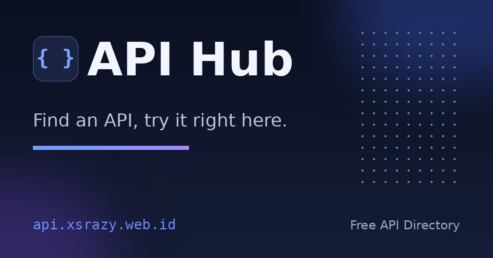
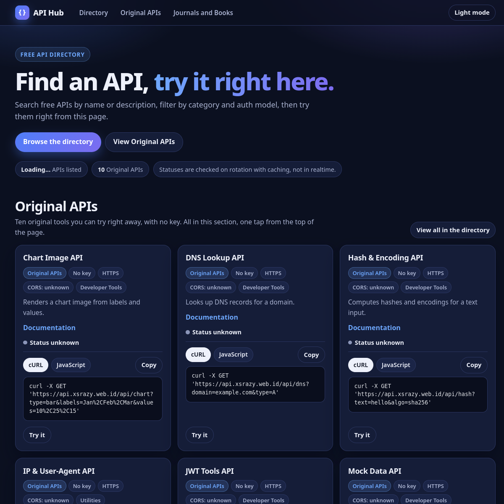

# API Hub

Find an API, try it right here. A free API directory with a try-it sandbox, rolling liveness checks, and ten original tools that need no key.

Live: https://api.xsrazy.web.id

## About

API Hub is a directory of free APIs that you can try without leaving the page. It lists 2,007 APIs with category and auth filters, text search, and a per-entry liveness status that is rechecked on rotation. Every card carries a try-it sandbox with editable parameters and cURL and JavaScript snippets. Third-party APIs run through a guarded proxy, while the ten Original APIs run on this project's own serverless functions and need no key.

A built-in URL shortener with click counting rounds out the toolset.

## Features

- Directory of 2,007 APIs with server-side pagination (60 per page), category and auth filters, text search, and no-key-first ordering. The `?page=` URL parameter is honored on load and kept in sync while paging.
- Liveness status on every entry, rechecked on rotation: a scheduled check probes 300 entries every 15 minutes, covering the whole catalog in about 2 hours. Each entry shows its own last-checked time. States are Online, Bot-limited, Status unknown, Needs parameters, and Unavailable with the HTTP status. Seed snapshots fill in entries that have not been probed yet in a fresh instance and expire after 48 hours.
- Ten Original APIs, all keyless: Mock Data, Chart Image, Site Check, Hash and Encoding, JWT Tools, Regex and Cron, IP and User-Agent, DNS Lookup, Weather, and URL Shortener.
- Try-it sandbox on every card: editable parameters, live response viewer, and cURL and JavaScript snippets. Own tools are called directly. Third-party APIs go through `/api/proxy`, which only allows public hosts, re-checks redirect hops (max 3), times out after 8 seconds, and caps bodies at 256 KB.
- URL shortener backed by a private Blob store: random 6-character codes, collision retries, click counting, `/s/:code` redirects, and a friendly HTML page for unknown codes instead of raw JSON.
- Dark and light themes, persisted in the browser. Fully English interface, with Open Graph and Twitter cards, JSON-LD, `robots.txt`, and a sitemap.

## Screenshots

Captured from the live site. The stats line was still loading when this shot was taken.

## Architecture

No framework and no build step. A single static page talks to zero-dependency Node.js Vercel Functions.

- Frontend: `index.html` plus `assets/app.js` and `assets/styles.css`. Vanilla JavaScript fetches the `/api/*` endpoints, renders cards, pagination, filters, the sandbox panels, and the theme toggle (persisted in `localStorage`).
- Backend: `api/*.js`, one file per endpoint, using only Node.js built-ins plus `fetch`. Shared helpers (JSON responses, query parsing, timeout fetch, in-memory cache, Blob access, SSRF guards) live in `api/_lib.js`.
- Data: the directory is sharded JSON (`catalog-00.json` through `catalog-09.json` plus `catalog-manifest.json`) so no single deploy payload exceeds the upload limit. `status-seed-*.json` holds fallback liveness snapshots. Hidden entries are never served.
- State: the shortener and the rolling check state live in one JSON document in a private Vercel Blob store, accessed with read-modify-write. The concurrent-write race in the shortener (two simultaneous shortens can drop one code) is documented in `api/shorten.js` and accepted: codes are random, collisions are retried, and a lost code simply never resolves.
- Hosting and deploy: Vercel project `api-hub` at `api.xsrazy.web.id`. The project is connected to this repository, so every push to `main` auto-deploys. A `*/15 * * * *` cron in `vercel.json` hits `/api/check` to drive the rolling checks. Function limits are 60 seconds for `/api/check` and 30 seconds for the other endpoints.

## API

Base URL: `https://api.xsrazy.web.id`. All JSON endpoints return `{ "error": "..." }` with a 4xx status on invalid input. `OPTIONS` returns 204 everywhere.

| Method | Endpoint | Parameters and rules |
|---|---|---|
| GET | `/api/catalog` | `page` (clamped to the last page), `pageSize` (max 60), `category`, `auth`, `own=1`, `q`. Hidden entries are excluded. Sorted no-key first, then by name. Returns `total`, `totalDisplayed`, `ownCount`, `page`, `pageSize`, `totalPages`, `categories`, `entries`. |
| GET | `/api/check` | No parameters. Returns the current liveness results for all entries. Also the cron target: each call probes the next 300-entry slice. |
| GET | `/api/search` | `q` (required, minimum 2 characters). Searches 6 active sources, 10 results each, 1 hour cache, 8 second upstream timeout. |
| GET | `/api/proxy` | `url` (required). Public hosts only, max 3 redirect hops, 8 second timeout, 256 KB body cap, `truncated` flag when capped. |
| GET | `/api/check-site` | `url` (required, public host only). Returns `status`, `ms`, `redirects`, `title`, `description`. |
| GET | `/api/mock` | `type` (`users`, `posts`, `products`, `todos`), `limit` (1 to 50, default 5). Static placeholder data, no external calls. |
| GET, POST | `/api/chart` | `labels` and `values` (comma separated on GET, arrays on POST), `type` (`bar`, `line`, `pie`), `title`. Max 20 points. Returns `image/svg+xml`, 640x360. |
| GET | `/api/hash` | `text` (required), `mode` (`hash`, `hmac`, `strength`, `b64encode`, `b64decode`, `urlencode`, `urldecode`), `algo` (`sha256`, `sha1`, `sha512`, `md5`), `key` (required for `hmac`). GET only. |
| GET, POST | `/api/jwt` | `token` (required), optional `secret` for HS256 signature checks. Decodes header and payload without a secret. |
| GET, POST | `/api/regex` | `pattern`, `text`. Invalid patterns return a 400 with the engine message. The same endpoint also explains 5-field cron expressions with next run times. |
| GET | `/api/ip` | No parameters. Returns `ip`, `userAgent`, and parsed `browser`, `os`, `device`, `language`. |
| GET | `/api/dns` | `domain` (required), `type` (`A`, `AAAA`, `MX`, `TXT`, `CNAME`, `NS`; default `A`). Resolved via Google DNS over HTTPS, 1 hour cache. |
| GET | `/api/weather` | `city` (required, 20 Indonesian cities). Current weather via Open-Meteo, 1 hour cache. |
| GET, POST | `/api/shorten` | POST JSON `{ "url" }`: only `http:` and `https:` URLs on public hosts. Returns `code` and `shortUrl`. GET `?code=` returns the stored URL with `clicks` and `createdAt`. Returns 503 when the shortener store is unavailable. |
| GET | `/api/redirect` | Served as `/s/:code`. 302 redirect to the stored URL with best-effort click counting. Unknown codes return a friendly HTML 404 page. |

## Environment Variables

Names only. No values are stored in this repository.

| Name | Purpose |
|---|---|
| `BLOB_READ_WRITE_TOKEN` | Created automatically by Vercel when the Blob store is linked. Required by the shortener and the redirect endpoint; without it they return 503. No other environment variables are used. |

## Notes

- Last verified November 4, 2026: 2,007 directory entries displayed, 10 Original APIs, rolling checks running on the 15-minute schedule.
- Directory data comes from the public-apis collection (MIT license), with attribution on the site. Liveness probes check that the linked site responds; they do not verify that every endpoint of a listed API works with correct parameters.
- The shortener's read-modify-write race is accepted by design; see `api/shorten.js`.

## Credits

- Directory data: [public-apis](https://github.com/public-apis/public-apis) contributors (MIT license).
- Weather data: [Open-Meteo](https://open-meteo.com/). DNS data: Google Public DNS over HTTPS.

## License

MIT. Copyright (c) 2026 Rahmatul Usra. See [LICENSE](LICENSE).
